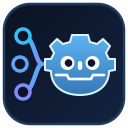
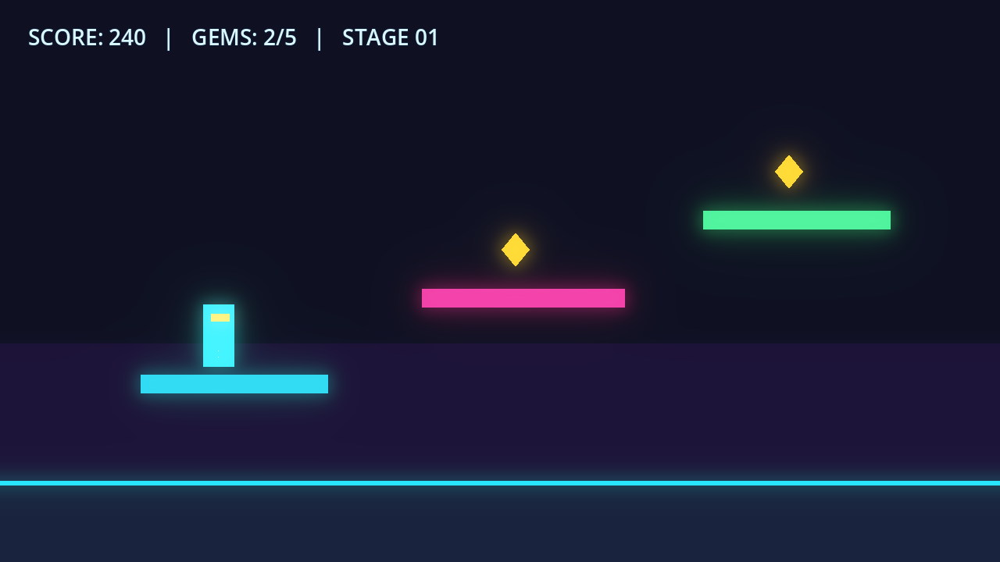
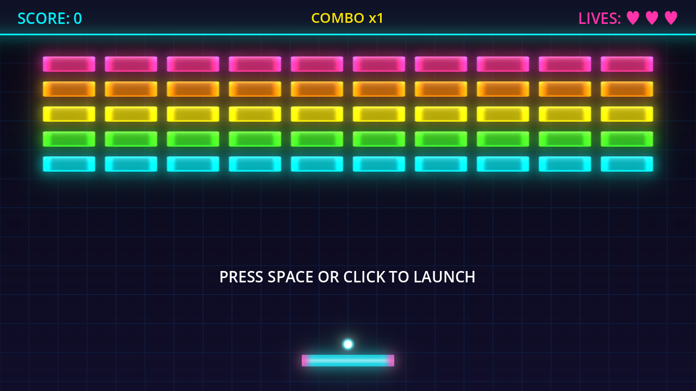
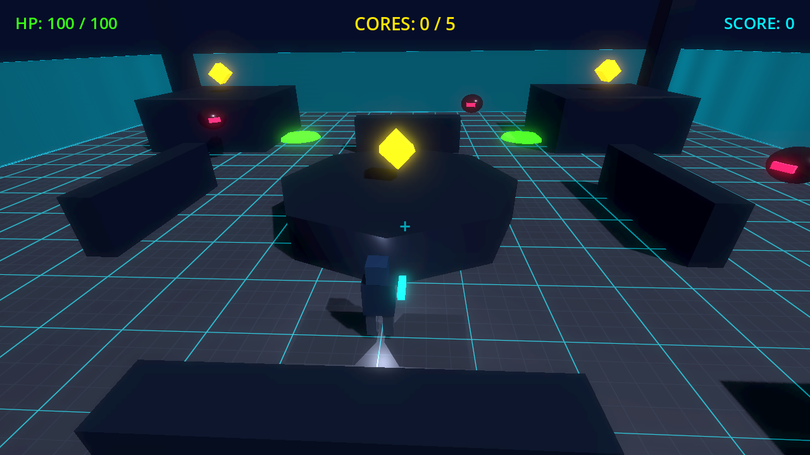

<p align="center">
  
</p>

# godot-mcp

A completely local, pure-GDScript Model Context Protocol (MCP) server running inside the Godot 4 editor. AI coding assistants (Claude Code, Cursor, VS Code, Claude Desktop, and local LLM clients) can inspect, build, refactor, debug, and playtest both 2D and 3D Godot projects in real time.

- **100% Pure GDScript**: No Python, no Node.js, no external runtime required.
- **180 Built-in Tools**: Full coverage across scene graphs, batch operations, 2D/3D physics, CSG, shaders, materials, lighting, particles, AnimationTree, TileMapLayer, GridMap, audio buses, localization, script validation, and live runtime playtesting.
- **Localhost Only**: Binds exclusively to `127.0.0.1` (default port `9777`, auto-increments if multiple Godot instances are open). Zero telemetry, zero outbound network calls.
- **Zero-Dependency Stdio Bridge**: Includes `bridge/stdio_bridge.sh` (POSIX `sh` + `curl`) for stdio-only MCP clients.
- **Extensible & Safe**: Supports read-only mode, compact tool discovery mode, and project-local custom tools under `res://mcp_tools/`.

---

## Demo Games Built with godot-mcp

| Demo | Description | Screenshot |
| --- | --- | --- |
| **2D Neon Platformer** | 2D neon platformer scene with `canvas_glow` bloom, glowing platforms, collectibles, particle trail, and HUD. |  |
| **Brick Breaker Neon** | 2D neon arcade brick breaker with bloom glow, combo HUD, particle effects, and custom shaders. |  |
| **Chrono Citadel 3D** | 3D action-arena prototype with grid shader floor, glowing energy cores, enemy drones, dynamic lighting, and third-person camera. |  |

---

## Requirements

- Godot **4.3+** (tested on Godot **4.7.2**)
- `sh` and `curl` only if using the optional stdio bridge

---

## Installation

1. Copy `addons/local_mcp` into your Godot project's `addons/` directory.
2. Open your project in Godot and go to **Project > Project Settings > Plugins**.
3. Enable **Local MCP**.
4. Verify in the Godot Output panel:
   ```text
   [Local MCP] Listening on http://127.0.0.1:9777/mcp (localhost only, 180 tools)
   ```

Tip: You can copy the ready-to-use connection snippet at any time from **Project > Tools > Local MCP: Copy connection info**.

---

## Connecting Your AI Client

Default endpoint: `http://127.0.0.1:9777/mcp` (Streamable HTTP / JSON-RPC 2.0). Godot must be open with the plugin enabled.

### Claude Code
```bash
claude mcp add --transport http godot http://127.0.0.1:9777/mcp
```

### Cursor (`.cursor/mcp.json`)
```json
{
  "mcpServers": {
    "godot": {
      "url": "http://127.0.0.1:9777/mcp"
    }
  }
}
```

### VS Code (`.vscode/mcp.json`)
```json
{
  "servers": {
    "godot": {
      "type": "http",
      "url": "http://127.0.0.1:9777/mcp"
    }
  }
}
```

### Stdio-Only Clients (Claude Desktop, etc.)
Use the included shell bridge (`bridge/stdio_bridge.sh`):
```json
{
  "mcpServers": {
    "godot": {
      "command": "sh",
      "args": ["/ABS/PATH/TO/addons/local_mcp/bridge/stdio_bridge.sh"],
      "env": {
        "LOCAL_MCP_URL": "http://127.0.0.1:9777/mcp"
      }
    }
  }
}
```
Optional environment variables for `stdio_bridge.sh`:
- `LOCAL_MCP_URL`: Override target URL (useful when running multiple Godot instances on `9778`, `9779`, etc.).
- `LOCAL_MCP_TOKEN`: Bearer token if authentication is enabled in Project Settings.

---

## Tool Architecture (180 Tools)

| Module | Scope |
| --- | --- |
| `mcp_tools.gd` | Central tool registry, 15-category index, shared helpers, `read_only` & `compact_mode` guards, custom `res://mcp_tools/` loader |
| `tools/project_tools.gd` | Project settings, statistics, input map & presets, autoloads, export presets, plugins, git status (15 tools) |
| `tools/file_tools.gd` | `res://` & `user://` files, directories, search, import settings, config files, broken references (18 tools) |
| `tools/scene_tools.gd` | Scene open/create/save/reload, scene tree, metrics, dependencies, warnings, branch saving (12 tools) |
| `tools/node_tools.gd` | Node creation, batch ops, hierarchy, properties, groups, unique names, signals, timers (16 tools) |
| `tools/script_tools.gd` | GDScript creation, attachment, validation, linting, symbol refactor, ClassDB lookup (11 tools) |
| `tools/editor_tools.gd` | Selection, undo/redo, editor screen, camera focus, viewport screenshot, `discover_tools`, `reload_custom_tools` (12 tools) |
| `tools/resource_tools.gd` | Resources, duplication, gradients, noise textures, curves, translations (9 tools) |
| `tools/visual_tools.gd` | Shaders, lighting, cameras, world environment, particles, sprite frames, parallax, viewports (13 tools) |
| `tools/ui_tools.gd` | StyleBoxes, themes, overrides, anchors, containers, LabelSettings (6 tools) |
| `tools/animation_tools.gd` | AnimationPlayer tracks, AnimationTree playback, state machines, blend spaces (7 tools) |
| `tools/audio_tools.gd` | Audio buses, audio players, AudioStreamRandomizer (4 tools) |
| `tools/tile_tools.gd` | TileMapLayer cells, terrain painting, TileSets, GridMaps, MeshLibraries (9 tools) |
| `tools/world_tools.gd` | Primitive meshes, CSG shapes, MultiMesh, paths, skeletons, node arrangement (7 tools) |
| `tools/physics_tools.gd` | Collision shapes, mesh collision, joints, raycasts, physics layers, navigation (7 tools) |
| `tools/runtime_tools.gd` & `runtime/mcp_runtime.gd` | Play/stop project, output logs, breakpoints, test runner, multiplayer, live `game_*` runtime inspection & input (34 tools) |

### Tool Categories for LLM Discovery

All 180 tools are indexed into 15 functional categories in `mcp_tools.gd` and exposed through `discover_tools` (`category` + `query` filters):

- `project` (15), `filesystem` (14), `scene` (12), `node` (16), `script` (11), `editor` (10), `resource` (9), `visual` (13), `ui` (6), `animation` (7), `audio` (4), `tilemap_world` (16), `physics_nav` (7), `runtime` (34), `toolkit` (6)

---

## Example Tool Calls and Outputs

### 1. Inspect Project Info (`get_project_info`)
Request:
```json
{
  "jsonrpc": "2.0",
  "id": 1,
  "method": "tools/call",
  "params": { "name": "get_project_info", "arguments": {} }
}
```
Response:
```json
{
  "name": "ChronoCitadel3D",
  "godot_version": "4.7.2-stable",
  "main_scene": "res://main_menu.tscn",
  "viewport": { "width": 1280, "height": 720 },
  "renderer": "Forward Plus"
}
```

### 2. Batch Build a Node Hierarchy (`batch_add_nodes`)
Request:
```json
{
  "name": "batch_add_nodes",
  "arguments": {
    "nodes": [
      {
        "name": "Player",
        "type": "CharacterBody2D",
        "properties": { "position": [400, 550] },
        "children": [
          { "name": "Sprite", "type": "ColorRect" },
          { "name": "Col", "type": "CollisionShape2D" }
        ]
      }
    ]
  }
}
```
Response:
```json
{
  "added": ["Player", "Player/Sprite", "Player/Col"],
  "count": 3
}
```

### 3. Compile-Check All GDScript Files (`validate_all_scripts`)
Request:
```json
{
  "name": "validate_all_scripts",
  "arguments": {}
}
```
Response:
```json
{
  "checked": 3,
  "failed": [],
  "failed_count": 0,
  "ok": true
}
```

### 4. Inspect Live Running Game UI (`game_get_ui_elements`)
Request:
```json
{
  "name": "game_get_ui_elements",
  "arguments": { "interactive_only": true }
}
```
Response:
```json
{
  "count": 1,
  "elements": [
    {
      "center": [640.0, 377.5],
      "disabled": false,
      "name": "StartButton",
      "path": "/root/MainMenu/StartButton",
      "rect": { "h": 85.0, "w": 380.0, "x": 450.0, "y": 335.0 },
      "text": "ENTER CITADEL",
      "type": "Button",
      "visible": true
    }
  ]
}
```

### 5. Step Frames & Simulate Input (`game_send_input`, `game_step_frames`)
Request:
```json
{
  "name": "game_send_input",
  "arguments": {
    "events": [
      { "type": "mouse_button", "button": 1, "position": [640.0, 377.5], "hold": 0.1 }
    ]
  }
}
```
Response:
```json
{
  "events_sent": 1
}
```

### 6. Live Performance Monitors (`game_get_performance_monitors`)
Response:
```json
{
  "fps": 60.0,
  "process_ms": 0.84,
  "physics_ms": 0.31,
  "draw_calls": 42,
  "objects": 318,
  "orphan_nodes": 0
}
```

---

## Custom Project Extensions (`res://mcp_tools/`)

Projects can register additional project-specific tools without modifying `addons/local_mcp`. Place GDScript files under `res://mcp_tools/` implementing `register_tools(host)` and call `reload_custom_tools` to hot-reload them.

---

## Security & Safety

- Binds strictly to `127.0.0.1`.
- Supports `read_only` mode in Project Settings to block all mutating tools during inspection sessions.
- All editor scene/property mutations use `EditorUndoRedoManager` so every AI edit can be undone cleanly with `Ctrl+Z` / `Cmd+Z` or the `undo` tool.
